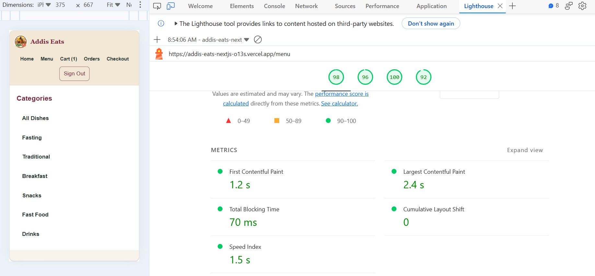

# Addis Eats — Day 45 Performance Report

## Lighthouse Results

Tested the deployed menu page using Microsoft Edge, Mobile mode.

| Metric | Before | After |
|---|---:|---:|
| Performance score | 91 | 98 |
| First Contentful Paint | 1.3 s | 1.2 s |
| Largest Contentful Paint | 2.8 s | 2.4 s |
| Total Blocking Time | 260 ms | 70 ms |
| Cumulative Layout Shift | 0 | 0 |
| Speed Index | 1.7 s | 1.5 s |

## Optimization made

Updated responsive image sizing in `components/DishList.jsx` and added a size hint for the logo in `app/menu/page.js`.

The deployed Lighthouse score increased from 91 to 98 in the recorded tests. LCP decreased from 2.8 seconds to 2.4 seconds.

## Remaining measurements

- First Load JavaScript for `/menu`: Not measured yet.
- Largest image file size: Not measured yet.

## Evidence

Keep screenshots of the before-and-after Lighthouse reports as evidence.

## Lighthouse Evidence

### After optimization — Deployed website

Performance score: 98

## Additional Measurements

- Largest listed image: 99.6 KiB (`hero-dish.jpg`), below the 150 KiB target.
- Next.js 16.3.5 bundle analyzer, `/menu` client bundle: 120.78 KB compressed (estimated), 291.22 KB uncompressed, 102 modules.
- First Load JavaScript: The traditional metric was not directly reported by the build output. The bundle analyzer estimate above is not equivalent, so the under-120-kB target remains unverified.

## Evidence

The recorded before-and-after Lighthouse metrics appear in the table above. The screenshot of the latest deployed Lighthouse report is saved at:

